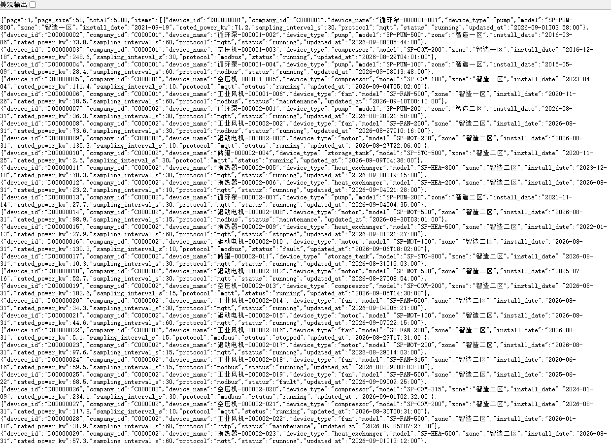
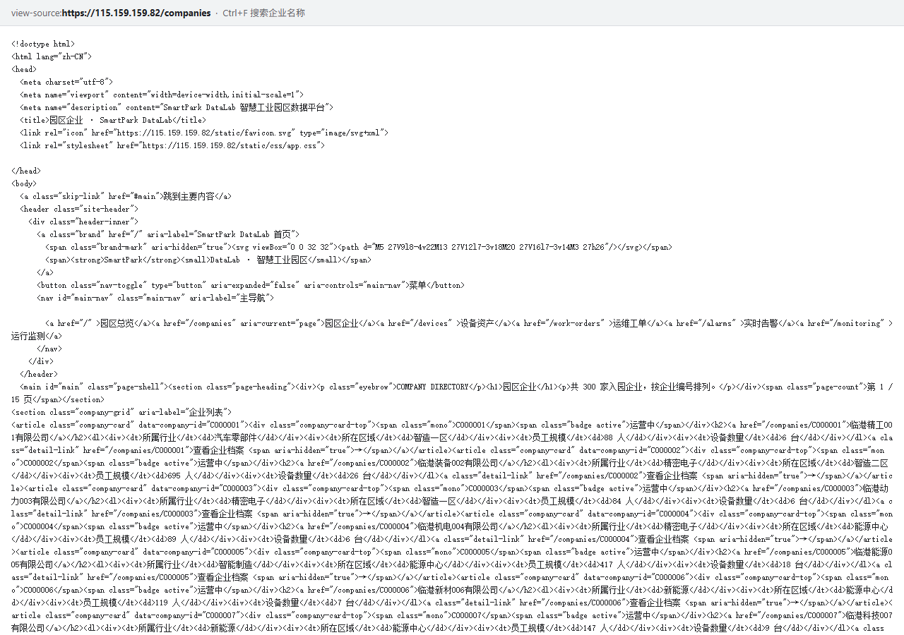
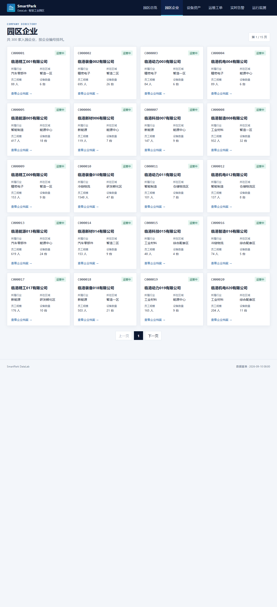
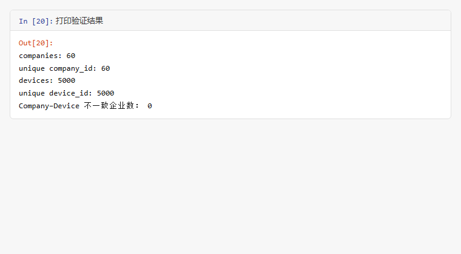

# Lab 1 实验报告

## 学生信息

- **姓名：** 李锐
- **学号：** 112404260119
- **班级：** 数据1241
- **GitHub 用户名：** lirui-qwe
- **仓库地址：** https://github.com/lirui-qwe/bigdata-collection-labs-112404260119

> 文件位置：`lab01/REPORT.md`
> 完整代码保存在 `lab1_html_api.ipynb`。
> 本报告只填写关键发现、关键代码、结果和指定截图。

---

# 任务 1：判断数据加载方式

## 1.1 Device：判断动态加载并找到 API

### 判断结果

- 页面：`/devices`
- 数据加载方式：**动态加载**
- 判断依据：

1. 在 `/devices` 页面“右键 → 查看网页源代码”中搜索页面上的设备名称，**找不到**；说明设备数据不随初始 HTML 返回。
2. 在 `F12 → Network → Fetch/XHR` 中刷新页面，找到返回设备列表的请求 `/api/devices`，其响应为 JSON，包含 `total`、`page_size`、`items` 字段。

### API 信息

- Request URL：`https://115.159.159.82/api/devices`
- Request Method：`GET`
- Query 参数：`page=1`、`page_size=50`

### 【截图 1】Device API 发现证据

文件名：

```text
images/01_device_api.png
```

插入：

```markdown

```

---

## 1.2 Company：判断静态加载

- 页面：`/companies`
- 数据加载方式：**静态加载**
- 判断依据：

使用“右键 → 查看网页源代码”后，能在源代码中搜索到页面中真实显示的企业名称（如“临港精工001有限公司”对应 `<article class="company-card" data-company-id="C000001">`），说明企业数据随 HTML 一起返回，按静态页面处理。

### 【截图 2】Company 静态加载证据

文件名：

```text
images/02_company_source.png
```

插入：

```markdown

```

---

# 任务 2：Device API 分页采集

## 2.1 API 分页结构

| 含义 | JSON 字段 |
|---|---|
| 当前页 | `page` |
| 每页条数 | `page_size` |
| 设备总数 | `total` |
| 设备列表 | `items` |

## 2.2 关键代码

```python
# 从第一页响应中读取分页信息
total = data["total"]
page_size = data["page_size"]

total_pages = (total + page_size - 1) // page_size

devices = []

for page in range(1, total_pages + 1):
    r = requests.get(
        api_url,
        params={
            "page": page,
            "page_size": page_size
        },
        timeout=10
    )

    page_data = r.json()
    page_items = page_data["items"]
    devices.extend(page_items)
```

## 2.3 采集结果

- 每页条数：50
- 设备总数：5000
- 程序计算得到的总页数：100
- 最终采集设备数：5000
- 唯一 `device_id` 数：5000

回答：

> 为什么总页数应由 API 返回的 `total` 和 `page_size` 计算，而不是直接在代码里写死？

答：数据总量可能随平台更新而变化，写死页数会导致漏采或越界。根据接口元数据 `total` 与 `page_size` 计算总页数，无论数据如何变化都能保证采集完整、准确。

---

# 任务 3：Company HTML 解析

## 3.1 企业记录 Selector

- 企业记录 selector：`article.company-card`
- 第 1 页企业记录数：20

说明为什么选择这个 selector：

- 主要使用了 `class`，同时配合 `data-company-id` 属性定位企业编号。
- 观察 Elements 后发现每条企业记录的最外层都是 `<article class="company-card" data-company-id="...">`，语义明确且稳定。
- 最终采用 `article.company-card`，因为它短、语义清晰，不依赖 `nth-child` 等易受结构变化影响的写法。

## 3.2 关键代码

```python
cards = soup.select("article.company-card")

card = cards[0]

company_id = card.get("data-company-id")
name = card.select_one("h2 a").get_text(strip=True)
status = card.select_one(".company-card-top .badge").get_text(strip=True)
```

行业、区域、设备数量使用 `dt/dd` 结构后，先转成字典再取值：

```python
details = {}
for item in card.select("dl > div"):
    key = item.select_one("dt").get_text(strip=True)
    value = item.select_one("dd").get_text(strip=True)
    details[key] = value

industry = details["所属行业"]
zone = details["所在区域"]
device_count = int(details["设备数量"].split()[0])
```

## 3.3 字段来源说明

1. 字段：`company_id`
   - 来自：HTML 属性
   - 使用的方法：`card.get("data-company-id")`

2. 字段：`name`
   - 来自：文本
   - 使用的方法：`card.select_one("h2 a").get_text(strip=True)`

---

# 任务 4：Company “下一页”分页

## 4.1 下一页元素

- “下一页” selector：`nav.pagination a:last-child`
- 第 1 页 `href` 示例：`/companies?page=2`

### 【截图 3】Company “下一页”元素

文件名：

```text
images/03_company_next.png
```

插入：

```markdown

```

## 4.2 关键代码

```python
next_link = soup.select_one("nav.pagination a:last-child")

next_href = next_link.get("href")

next_url = urljoin(
    current_url,
    next_href
)
```

再用 2～3 句话说明：

> 你的程序如何完成“当前页 → 找下一页 href → 请求下一页 → 再解析”的循环？

答：程序把“请求当前页 → 解析本页企业 → 定位 `nav.pagination a:last-child` 读取 href → 用 `urljoin` 拼出下一页 URL”放入循环体，每轮结束后把 `current_url` 更新为下一页地址，连续执行 3 次即采集 3 页。

## 4.3 三页采集结果

| 页码 | 企业数 |
|---|---:|
| 1 | 20 |
| 2 | 20 |
| 3 | 20 |
| **合计** | 60 |

- 唯一 `company_id` 数：60

---

# 任务 5：结果验证

## 5.1 最终结果

| 检查项 | 结果 |
|---|---:|
| Company 总数 | 60 |
| 唯一 `company_id` | 60 |
| Device 总数 | 5000 |
| 唯一 `device_id` | 5000 |
| Company–Device 不一致企业数 | 0 |

### 【截图 4】最终验证结果

文件名：

```text
images/04_validation.png
```

插入：

```markdown

```

## 5.2 一致性检查关键代码

```python
from collections import Counter

device_counts = Counter(
    x["company_id"] for x in devices
)

mismatch_count = 0

for company in companies:
    cid = company["company_id"]
    expected = company["device_count"]
    actual = device_counts.get(cid, 0)

    if expected != actual:
        mismatch_count += 1
```

回答：

> 为什么 `status_code == 200` 仍然不能说明“数据已经采集正确”？

答：`200` 只表示 HTTP 请求成功返回了响应，不保证数据本身正确。还必须检查记录数量是否符合预期、`device_id`/`company_id` 是否唯一、以及 Company 页面声明的 `device_count` 与 Device 数据统计是否一致，才能确认采集结果真实可靠。

---

# 任务 6：保存采集结果

确认已经生成：

```text
data/companies.json
data/devices.json
```

填写：

- `companies.json`：**已生成**
- `devices.json`：**已生成**

---

# 实验结论

本实验完成了静态页面与动态 API 两类数据采集。动态加载的 Device 数据不随初始 HTML 返回，需在 Network 中找到 `/api/devices`，用 `total` 与 `page_size` 计算总页数后分页采集；静态加载的 Company 数据直接在 HTML 中，用 `article.company-card` 选择器配合 `data-company-id` 与 `dl > div` 结构解析字段。API 分页通过 `page` 参数翻页，HTML 分页则通过定位“下一页”`<a>` 的 `href` 连续请求。最后用数量、ID 唯一性和 Company–Device 一致性三项校验确认结果正确（60/60/5000/5000/0），并保存为 JSON 文件。
