# 实验二报告：房源采集与 MySQL 存储

- 班级：数据1241
- 姓名：李锐
- 学号：112404260119
- 实验日期：2026-10-27
- GitHub 仓库链接：https://github.com/lirui-qwe/bigdata-collection-labs-112404260119
- 源码文件名：`lab02/anjuke.ipynb`
- 数据库与表：`smartpark_lab.houseinfo`（L05 教学卷 `smartpark-student_l05-mysql-data`）
- 数据来源：在线教学站 http://www.bspider.top/anjuke/
- 访问时间及结果：2026-10-27 16:44 左右在线访问。用完整 Chrome 请求头请求首页返回 **HTTP 200**，页面标题“重庆二手房房产网，重庆二手房出售，重庆买房购房交易信息 - 58安居客”，首页解析出 **60** 条 `div.property`；若只把 UA 写成 `Mozilla/5.0`，同样返回 HTTP 200，但标题变成“访问验证-安居客”、房源节点为 0（见“问题与解决”）。
- 快照文件来源与文件名（在线实验可写“不适用”）：不适用（本次在线采集成功，未使用网页快照）

> 填写要求：截图放在 `images/` 中，在对应位置插入图片。代码截图要显示文件名、行号或单元位置，用红框标出关键代码，每项写2—3句话解释。只截最终结果或只贴 AI 生成的文字，不能代替实验过程。未完成的项目写明原因，不填写预期结果，不展示个人账号密码。

## 第一阶段：MySQL Docker 更新与启动

- 本次是否需要更新：**已按教师提供的 `L05_MySQL_学生环境增量更新包` 完成更新**。步骤：① 核对包内 `SHA256SUMS.txt`，5 个配套文件和 254 MB 离线镜像包校验全部通过；② 把 `l05-mysql-fresh-volume.yaml`、`start-mysql.bat`、`stop-mysql.bat`、`mysql-console.bat`、`l05-mysql.ps1` 复制到原课程目录（未覆盖 `docker-compose.yml`、`.env`、`workspace`）；③ 停止旧卷 MySQL（未删除旧卷 `smartpark-student_student-mysql-data`）；④ 用 `docker load` 导入包内 `mysql:8.4.11` 离线镜像，`docker image inspect` 的 ID 为 `sha256:85b9bf2e…`，与包内说明一致；⑤ 双击 `start-mysql.bat`，输出 `[PASS] L05 MySQL healthy，账号连接检查通过`。
- L05 环境使用独立教学卷 `smartpark-student_l05-mysql-data`，不再向宿主机映射 3306，JupyterLab 仍通过 `mysql:3306` 连接；旧卷保留未动。
- 更新或启动遇到的问题：
  1. **镜像 ID 不一致**：更新前本机 `mysql:8.4.11` 的 ID 是 `sha256:0f51e63e…`（此前从镜像源拉取），与包内说明要求的 `sha256:85b9bf2e…` 不同。按包内 README 先停旧容器、确认离线包 SHA256 后再 `docker load`，导入后 ID 与要求一致，才运行 `start-mysql.bat`。
  2. **旧卷 MySQL 必须先停**：`l05-mysql.ps1` 检测到旧卷 MySQL 正在运行会拒绝启动（保护数据）。先 `docker compose --profile mysql stop mysql`，旧卷数据完整保留。
  3. 进入命令行用包内 `mysql-console.bat`（自动使用 L05 账号和库），输入密码 `123456` 后出现 `mysql>`；终端另加 `--default-character-set=utf8mb4` 避免中文乱码。

### 启动环境与建表

课程 JupyterLab（`http://127.0.0.1:8888`）与 L05 MySQL 容器均在运行。`start-mysql.bat` 已完成建卷、启动和健康检查。在 MySQL 终端中执行 `USE smartpark_lab;`、`SHOW TABLES;`、`DESCRIBE houseinfo;`、`SELECT COUNT(*) AS before_count FROM houseinfo;`，结果如下图。L05 新卷是空库，建表后 `before_count` 为 0。

**截图：** MySQL 启动成功提示，以及终端中 `USE smartpark_lab`、`SHOW TABLES`、`DESCRIBE houseinfo` 的执行结果。可分图。

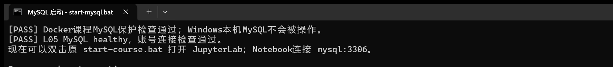

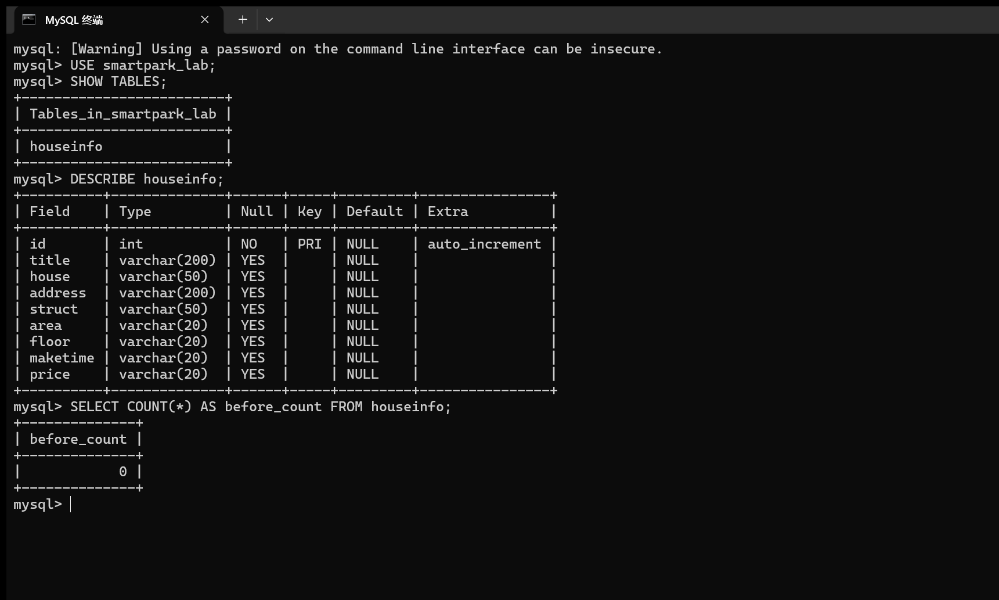

说明：当前使用哪个数据库？`id` 和8个房源字段分别保存什么？

答：当前使用 `smartpark_lab` 数据库（执行 `USE smartpark_lab` 后返回 `Database changed`）。`SHOW TABLES` 显示库中有 `houseinfo` 表；`DESCRIBE` 显示 9 列：`id` 是 `int`、`NO`、`PRI`、`auto_increment`，由数据库自动生成，不参与采集；其余 8 列分别是 `title`（标题，卖点文案）、`house`（楼盘）、`address`（地址）、`struct`(户型，如 `3室2厅1卫`)、`area`（建筑面积，保留 `㎡`）、`floor`（楼层，如 `低层(共27层)`）、`maketime`（建造年代，缺失填空字符串）、`price`（每平方米单价，保留 `元/㎡`）。建表后 `COUNT(*)` 为 **0**（`before_count = 0`），是本次入库前的基线。

## 第二阶段：房源采集与 CSV 数据存储

### 1. 网页分析与房源解析

#### 选择器是怎样得到的

在 Chrome 中按 F12，使用 **Elements → Copy → Copy selector**。选一个字段，记录从完整路径到相对选择器的过程。

- 选择的字段：第一条房源的标题 `h3`
- 复制的原始选择器：Copy selector 得到的是从页面根节点开始、包含多层 `div:nth-child(...)` 的**绝对路径**，层级很长，页面多插一个广告或推荐位就会错位，因此没有直接写进代码（原始长字符串未保留，只记录其结构特征）
- 一条房源的父容器选择器：`div.property`（第 1、2 条房源的容器 class 相同，每页 60 个）
- 最终使用的相对选择器：容器内 `h3`，即 `row.select_one("h3")`

**截图：** 框出该字段的 HTML 节点和房源父容器，展示选择器的匹配结果。

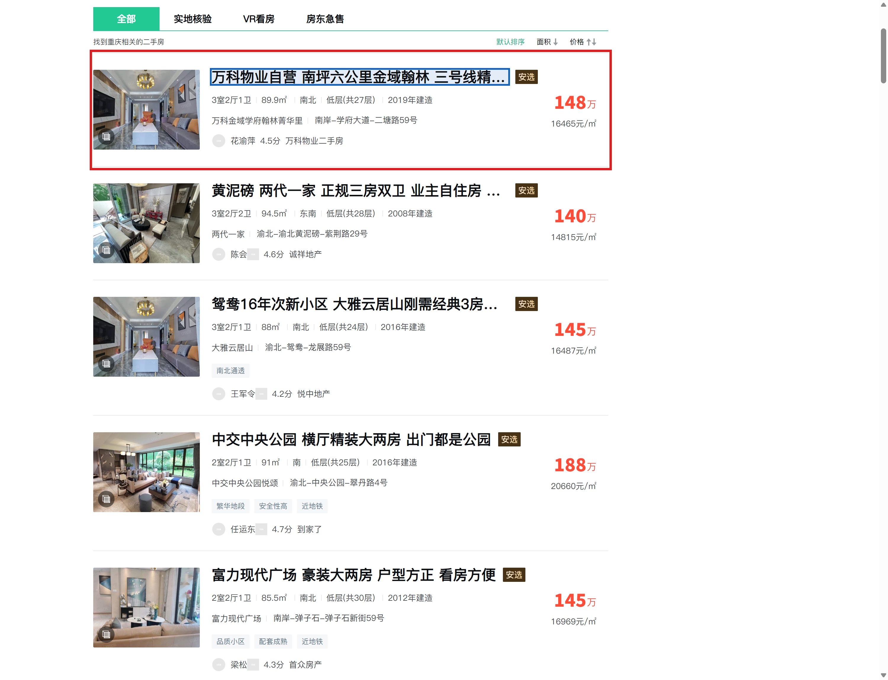

说明：删掉了哪些层级？怎样确认父容器刚好包含一条房源？

答：删掉了从页面根节点到列表区域之间所有按位置（`nth-child`）定位的层级，只保留“刚好包住一条房源”的父容器 `div.property`，再在它内部用相对选择器找字段。确认方法：① 代码中 `soup.select("div.property")` 返回 **60** 个节点，与本页显示的房源数一致；② 每个节点内都同时含标题、楼盘、地址、属性组和价格，且不含下一条房源的内容（截图里红框只框住第一条，蓝框是其中的 `h3`）；③ 第一条、第二条、最后一条都能用同一组相对选择器取到完整字段。

#### 解析8个字段

**截图：** 自己编写的解析代码和首条房源的8个字段输出。代码中必须框出：

- `select()` 和 `select_one()`。
- 面积、单价的定位与取值。
- 建造年代的提取和缺失处理。

可分成几张局部截图。另附面积、单价对应的 HTML 节点或网页原文。

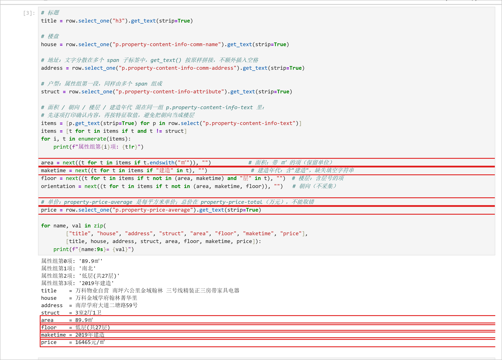

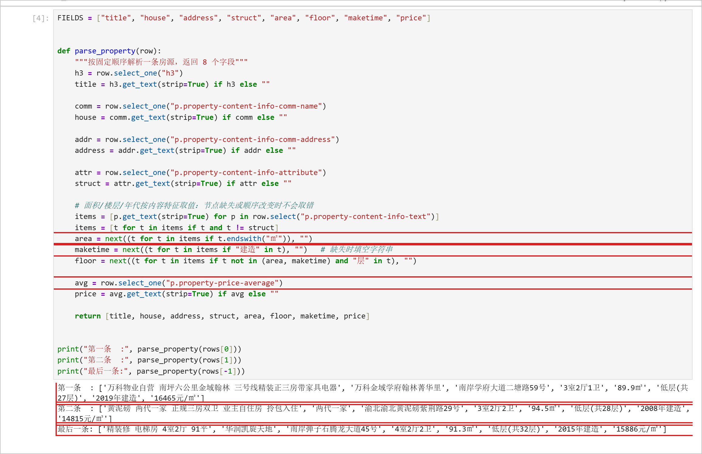

面积、单价对应的 HTML 原文（取自本次在线页面第一条房源）：

```html
<p class="property-content-info-text">89.9㎡</p>
<p class="property-content-info-text">2019年建造</p>
...
<p class="property-price-average">16465元/㎡</p>
```

同一条房源右侧的“148万”来自 `property-price-total`，是总价（单位“万”），单位与量纲都与要求的单价不同，不能取。

说明：两个选择方法各用在哪里？怎样确认面积和单价没有取错？

答：`select()` 用在整页范围（`soup.select("div.property")`）返回所有房源节点列表，列表中每一项对应一条房源；`select_one()` 用在单条房源内部，只取该字段的第一个匹配节点，找不到返回 `None`，因此取值前先判断节点是否存在。面积、楼层、建造年代都在同一组 `p.property-content-info-text` 里，按内容特征取值而不是按下标：面积取以 `㎡` 结尾的项；建造年代取包含“建造”的项，用 `next(..., "")` 在缺失时填空字符串；楼层取既不是面积也不是年代、且包含“层”的项，避免把“南北”这类朝向当成楼层。单价取 `p.property-price-average`（`16465元/㎡`），不取 `p.property-price-total`（`148万`）；取值后与网页原文逐字对照（`89.9㎡`、`16465元/㎡`、`2019年建造`），单位保留，确认没有取错。

### 2. 下一页采集

- 下一页 `href` 原值：`?page=2`（相对地址，只有查询参数）
- 用 `urljoin()` 补全后的地址：`http://www.bspider.top/anjuke/?page=2`
- 实际停止原因（明确禁用的末页按钮 / 异常中止）：**明确禁用的末页按钮**。第 1—9 页的按钮是 `a.next.next-active`，第 10 页该按钮的 class 只剩 `next`、`href` 变成 `#`，`a.next.next-active` 选不到节点，程序判定到达末页并正常结束；本次采集完整，不是异常中止。

**截图：** 框出提取 `href`、补全地址、循环更新地址和停止条件的代码。附前两页的运行日志，以及最终停止提示。离线实验展示快照中的href、补全结果和文件读取记录，注明“离线回放”，不算在线翻页成功。

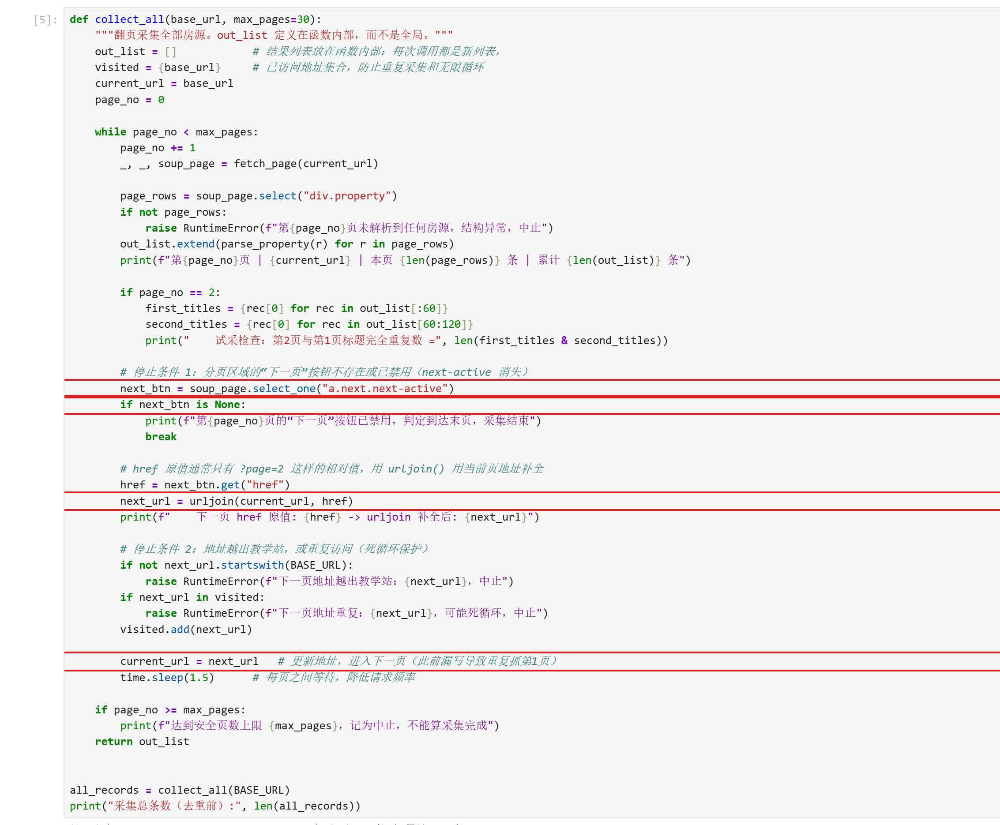

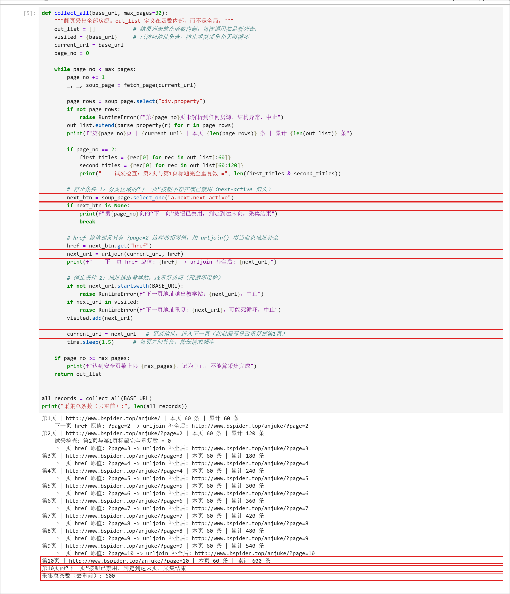

说明：怎样进入下一页？怎样防止重复采集或无限循环？若中途失败，说明停在哪一步。

答：每页解析完后用 `next_btn = soup_page.select_one("a.next.next-active")` 找活动的“下一页”按钮；取地址必须用 `next_btn.get("href")`（`get_text()` 得到的是“下一页”三个字，不是地址），再用 `urljoin(current_url, href)` 用当前页地址补全成完整 URL，最后 `current_url = next_url` 进入下一页。防重复和防死循环有四层：① `next_btn is None` 时不取地址，直接判定末页；② `next_url.startswith(BASE_URL)` 保证地址不越出教学站；③ `visited` 集合记录已访问地址，重复地址立即报错中止；④ `max_pages=30` 安全页数上限，达到上限只记为中止、不算采集完成；此外每页之间 `time.sleep(1.5)` 降低请求频率。日志中第 2 页与第 1 页标题完全重复数为 0，说明翻页确实换页；第 10 页后按钮禁用，程序正常结束。

### 3. 保存 CSV

**截图：** CSV保存与回读代码、回读条数。框出编码、表头和数据写入部分。

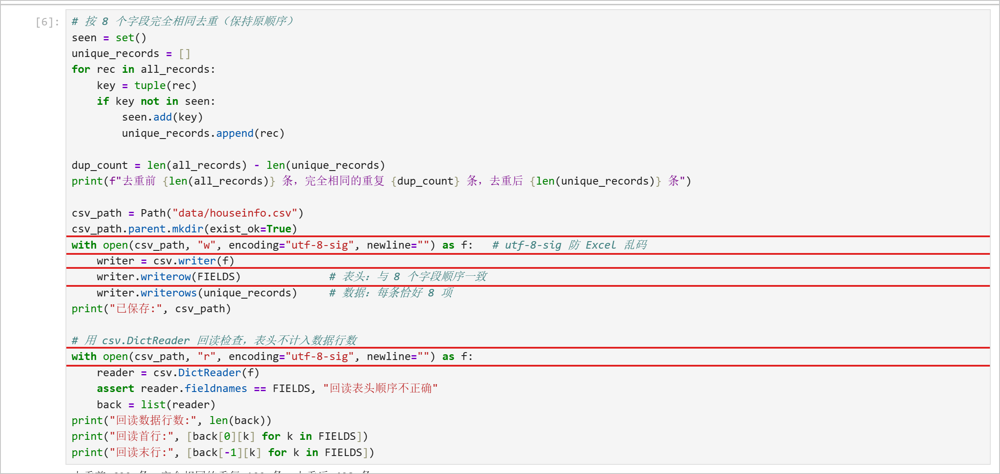

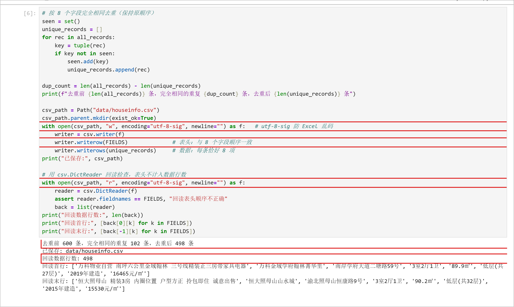

说明：8个字段的顺序是什么？按8个字段完全相同去重后，保存了多少条记录？

答：顺序为 `title → house → address → struct → area → floor → maketime → price`，与建表列顺序一致。按 8 个字段完全相同去重（保留首次出现的顺序）：去重前 **600** 条，完全相同的重复 **102** 条，去重后保存 **498** 条。写入用 `csv.writer`，文件参数 `encoding="utf-8-sig"`（防止 Excel 打开中文乱码）、`newline=""`，第一行写 8 个字段的表头，之后每条记录恰好 8 项。用 `csv.DictReader` 回读，断言表头与 `FIELDS` 一致，数据行 **498** 行（表头不计入），首行、末行字段完整。

## 第三阶段：MySQL 数据存储

### 1. 读取 CSV 并入库

本阶段读取第二阶段的 `data/houseinfo.csv`，不重新采集。

**截图：** 框出读取CSV、按8个字段整理入库参数的代码。

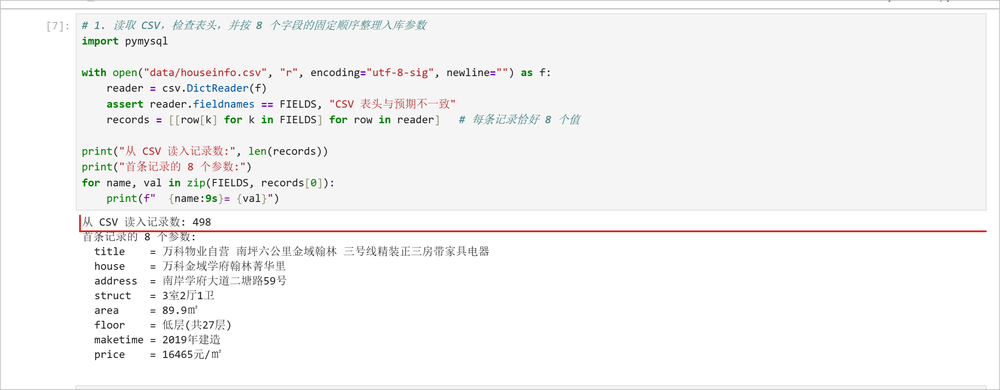

**截图：** 自己编写的入库代码。框出 `executemany()`、`commit()`、`rollback()`，以及关闭游标和连接的操作。另框出避免重复插入的代码。

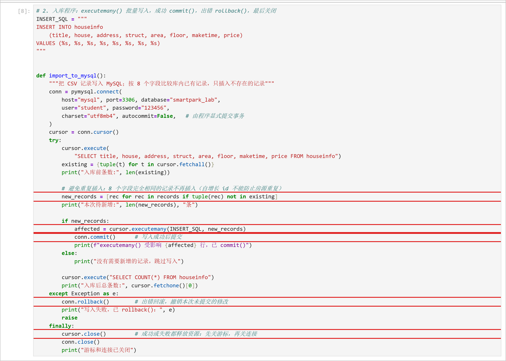

说明：每条记录怎样对应8个参数？成功、失败时分别做什么？再次运行时怎样避免重复插入？

答：`csv.DictReader` 读入后，按 `FIELDS` 的固定顺序把每行整理成 `[title, house, address, struct, area, floor, maketime, price]`，INSERT 语句中 8 个字段对应 8 个 `%s` 占位符，`executemany(INSERT_SQL, new_records)` 按位置一一绑定，全部通过参数传递，不用字符串拼接或 f-string。连接参数为 `host="mysql"`、`port=3306`、`database="smartpark_lab"`、`user="student"`、`password="123456"`、`charset="utf8mb4"`、`autocommit=False`。成功时 `executemany()` 返回受影响行数后调用 `conn.commit()` 提交；失败时 `except` 分支调用 `conn.rollback()` 撤销本次未提交的修改并重新抛出异常；无论成败都在 `finally` 中先 `cursor.close()` 再 `conn.close()` 释放资源。再次运行时，先 `SELECT` 出库内已有记录的 8 字段元组集合，只插入集合中不存在的记录（自增长 `id` 不能防止房源重复），所以重跑不会重复插入，也不需要清空表。

### 2. 核对结果

#### 查询条数和样本

**截图：** MySQL 终端中的入库前后 `SELECT COUNT(*)`、重跑后的条数，以及 `SELECT ... LIMIT 5` 的结果。

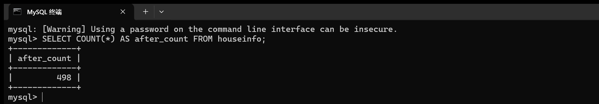

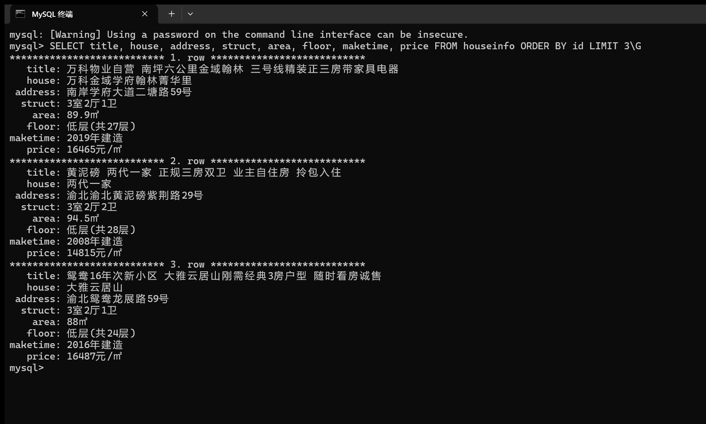

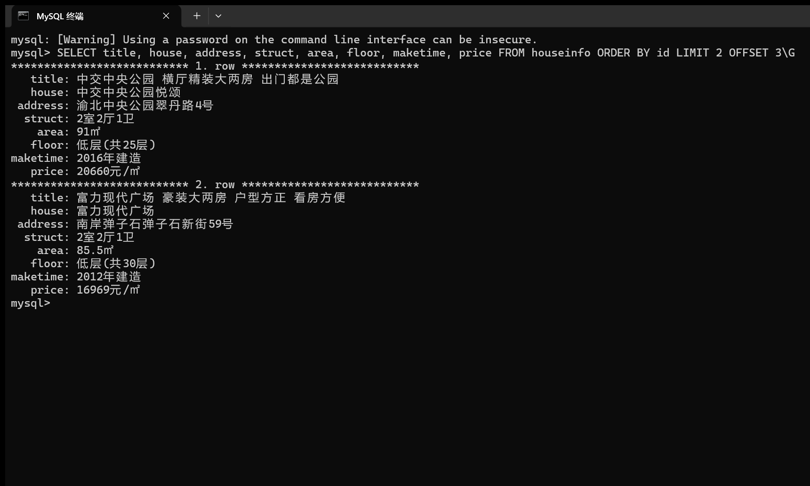

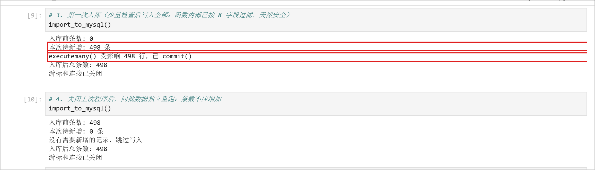

| 项目 | 实际结果 |
|---|---|
| 成功采集页数 | 10 页 |
| 采集记录数（去重前） | 600 |
| 完全相同的重复记录数 | 102 |
| CSV数据行数（不含表头） | 498 |
| 入库前条数 | 0 |
| 入库后条数 / 本次新增条数 | 498 / 498 |
| 关闭上次程序后，同批数据独立重跑的条数 / 新增条数 | 498 / 0 |
| 是否采集完整；未完成的原因 | 采集完整：第 10 页“下一页”按钮已禁用（`next-active` 消失），按停止条件正常结束；无未完成步骤 |

说明：首次入库后的条数应等于去重后的CSV数据行数，8个字段的内容也应一致。若不一致，说明原因。总条数以实际结果为准。

答：一致。首次入库后 `SELECT COUNT(*) AS after_count` 为 **498**，等于去重后 CSV 的数据行数 498，`executemany()` 受影响 498 行。第二次运行入库函数时“入库前条数 498、本次待新增 0 条”，跳过写入，总条数仍为 498，未重复增加。由于 `LIMIT 5` 横向表格比终端宽、纵向又超过一屏，样本分两张截图（第 1—3 条、第 4—5 条），均用 `\G` 完整显示 8 个字段。

#### 逐条核对

选取第一条、跨页一条和最后一条，比较网页、CSV与数据库中的8个字段。快照实验对照教师提供的网页文件。

**截图：** 三条样本的对照结果，框出面积、单价和年代。可分图。

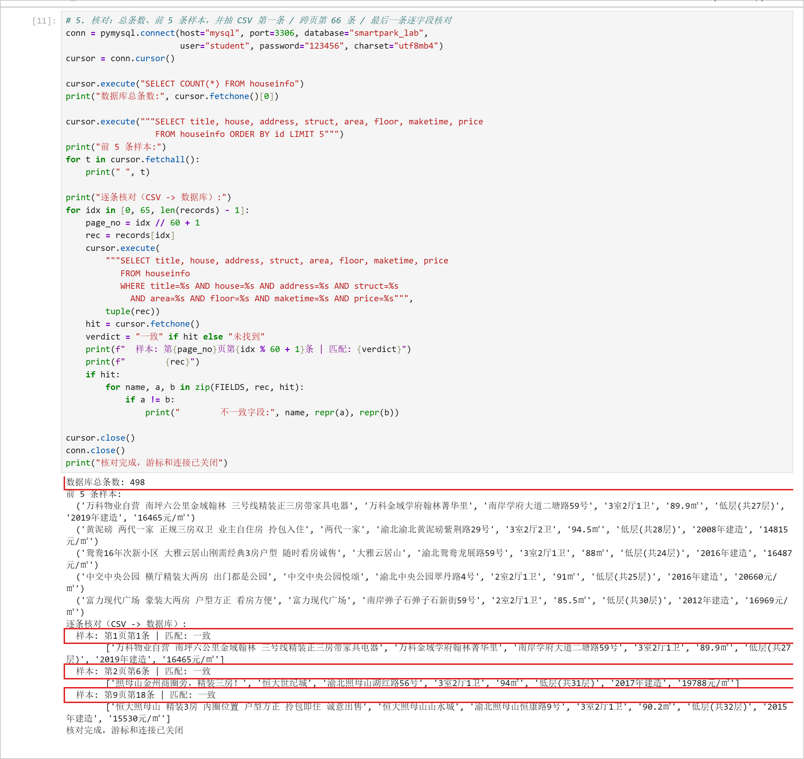

- 样本1（页码或URL、记录位置）：第 1 页第 1 条（`http://www.bspider.top/anjuke/` 第 1 条，`id=1`）——`万科物业自营 南坪六公里金域翰林 三号线精装正三房带家具电器`，面积 `89.9㎡`、单价 `16465元/㎡`、年代 `2019年建造`
- 样本2（页码或URL、记录位置）：第 2 页第 6 条（`http://www.bspider.top/anjuke/?page=2` 第 6 条，跨页样本，CSV 第 66 条）——`照母山金州商圈旁，精装三房！`，面积 `94㎡`、单价 `19788元/㎡`、年代 `2017年建造`
- 样本3（页码或URL、记录位置）：第 9 页第 18 条（`http://www.bspider.top/anjuke/?page=9` 第 18 条，即去重后 CSV 最后一条）——`恒大照母山 精装3房 内圈位置 户型方正 拎包即住 诚意出售`，面积 `90.2㎡`、单价 `15530元/㎡`、年代 `2015年建造`

核对结论及差异：三条样本（首页、跨页、末页）的 8 个字段在网页、CSV、数据库三处逐字段一致（程序按 8 字段做 `WHERE` 精确匹配，三条都返回“一致”），面积 `㎡`、单价 `元/㎡`、年代 `××××年建造` 的单位与格式保持原样，没有差异。

## 问题与解决

- 遇到的问题、处理方法及结果：
  1. **简短 UA 触发访问验证页**：按手册示例只用 `Mozilla/5.0` 作 UA 请求，返回 HTTP 200 但页面标题是“访问验证-安居客”、`div.property` 为 0；用 `curl/8.0` 也一样。处理：改用完整 Chrome 请求头（UA + Accept + Accept-Language + Referer），并在 `fetch_page()` 中检查页面标题，命中“访问验证”就抛异常停止采集，避免把验证页当房源页继续解析。结果：10 页全部正常返回。
  2. **L05 增量包与镜像 ID**：增量包最初只在下载目录，课程目录没有 5 个脚本；本机 `mysql:8.4.11` 的 ID（`0f51e63e…`）也与包内要求的 `85b9bf2e…` 不一致。处理：按包内 README 校验 SHA256、复制 5 个文件、停旧卷 MySQL、导入离线镜像后再运行 `start-mysql.bat`（旧卷未删）。结果：`[PASS] L05 MySQL healthy`，新卷 `l05-mysql-data` 建表和查询正常。
  3. **终端一屏放不下 5 条样本**：`SELECT ... LIMIT 5` 横向表格比终端宽，纵向 `\G` 又超过一屏。处理：样本分两张截图（第 1—3 条、第 4—5 条），均用 `\G` 完整显示 8 个字段；面积、单价、年代再用 Notebook 的逐条核对输出互相印证。
  4. **入库去重**：第一次入库写入 498 条；重跑时如果直接再 `executemany()` 会变成 996 条。处理：入库前先查库内已有的 8 字段集合，只插入不存在的记录；重跑输出“本次待新增 0 条”，总数保持 498。
- 尚未解决的问题、未完成的步骤（没有可写“无”）：无。在线采集、CSV、入库和核对全部完成；未使用网页快照。

## 思考题

1. 本次怎样实现下一页采集？结合自己的代码说明。

   答：每页解析完后用 `next_btn = soup_page.select_one("a.next.next-active")` 定位活动的“下一页”按钮；按钮存在时用 `href = next_btn.get("href")` 取到 `?page=2` 这类相对地址，再用 `next_url = urljoin(current_url, href)` 以当前页地址补全成完整 URL，并执行 `current_url = next_url` 进入下一页。停止条件有三层：按钮 `next-active` 消失（第 10 页，正常结束）、下一页地址越出教学站或已在 `visited` 中（结构异常/死循环，报错中止）、达到 `max_pages=30` 安全上限（记为中止）。本次在第 10 页因按钮被禁用而正常结束，共采 10 页 600 条。

2. 旧代码把 out_list 定义在全局。你把结果列表放在哪里？为什么？

   答：放在翻页函数 `collect_all()` 内部，作为局部变量 `out_list = []`。这样每次调用函数都会得到全新的列表，不会被上一次运行残留的数据污染；在 Notebook 里反复运行单元格时，全局列表会越积越多，导致重复统计和脏数据，局部变量从结构上避免了这类问题。

3. 你怎样获取建造年代？节点缺失或顺序改变时，怎样处理？

   答：建造年代混在属性组 `p.property-content-info-text` 里，不按下标取值，而是先取出整组文字，再用内容特征匹配：`maketime = next((t for t in items if "建造" in t), "")`。`next()` 的第二个参数是默认值，节点或该项缺失时返回空字符串而不是报错；因为按内容匹配而不是按位置下标，即使属性组里各项顺序改变（例如朝向和楼层对调）也不会取错。面积按“以 `㎡` 结尾”、楼层按“含层号且不是面积/年代”匹配，也是同样的思路。

## 提交检查

- [x] 实验一原仓库的 `lab02/` 中已有源码、CSV、报告和真实截图。
- [x] 截图清楚，关键代码已框出，每项附有个人解释。
- [x] GitHub上能打开文件和图片，未上传个人账号密码、`.env`或教师答案。
- [x] 未完成项已如实说明；学习通只交原仓库链接。

如使用 AI，简述它帮助了什么，以及自己修改、运行和核对了什么：使用 AI 协助整理报告结构、生成截图与核对脚本；采集、CSV 保存、入库和 MySQL 查询均在本机课程环境中实际运行，截图中的页码、条数、样本和报错都是本次真实运行结果，本人逐条核对了首条、跨页条和末条。

